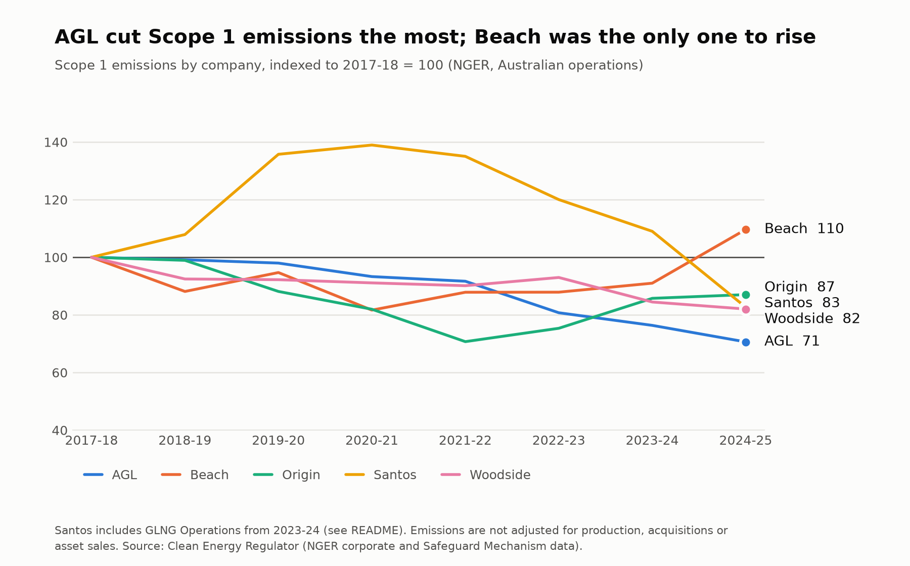
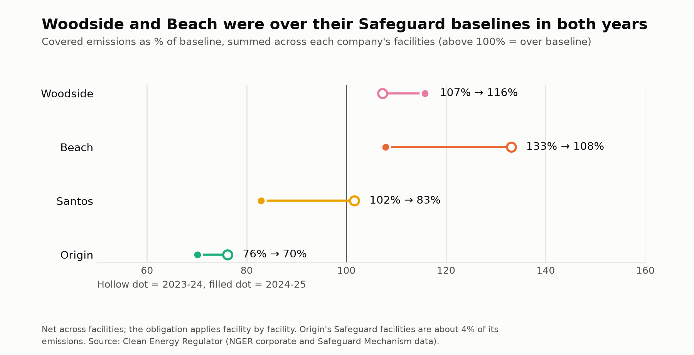
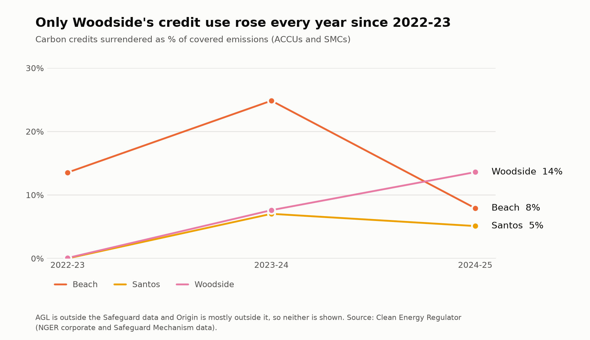

# Which ASX energy producers are really cutting emissions?

A comparison of five ASX-listed energy producers (AGL, Beach Energy, Origin, Santos and Woodside) using nine years of Clean Energy Regulator data, 2016-17 to 2024-25.

**Short answer.** On reported Scope 1 emissions, AGL cut the most between 2017-18 and 2024-25 (−29%). Woodside (−18%), Santos (−17%, or −27% if the Curtis Island GLNG plant is excluded) and Origin (−13%) cut less, and Beach rose (+10%). The data cannot show how much of each fall is a *real* cut: none of the figures is adjusted for production, acquisitions or asset sales, and part of Santos's fall is carbon capture and storage. Those limits are set out below, and they matter more than the ranking.



## Data

All from the [Clean Energy Regulator](https://cer.gov.au) (files in `data/raw/cer/`):

- **NGER corporate emissions**, 2016-17 to 2024-25: Scope 1 and 2 emissions by controlling corporation, Australian operations, July to June years.
- **Safeguard Mechanism facility data**, 2016-17 to 2024-25: covered emissions, baselines, and carbon credits surrendered, by facility. The regulator changed the table layout in 2023-24, when the reformed Safeguard Mechanism began (1 July 2023), so the code harmonises two layouts.
- **Company reports** (annual and climate reports from Woodside, Santos, Origin, AGL and Beach) were used to check the Santos figures. The PDFs are not included in this repository because of their size; they are public on each company's website.

## Method

1. `src/01_corporate_panel.py` builds a company-by-year table from the NGER files.
2. `src/02_safeguard_panel.py` builds a facility-by-year table from the Safeguard files and sums it to company level.
3. `src/03_charts.py` draws the three figures, the summary table, and the Santos sensitivity check.

## Results

Scope 1 emissions, Mt CO2-e (NGER):

| Year | AGL | Beach | Origin | Santos | Woodside |
|---|---|---|---|---|---|
| 2016-17 | 43.44 | – | 17.16 | 5.70 | 10.16 |
| 2017-18 | 43.10 | 0.50 | 18.15 | 5.39 | 9.97 |
| 2018-19 | 42.73 | 0.44 | 17.96 | 5.82 | 9.22 |
| 2019-20 | 42.23 | 0.47 | 16.00 | 7.32 | 9.19 |
| 2020-21 | 40.21 | 0.41 | 14.88 | 7.49 | 9.08 |
| 2021-22 | 39.51 | 0.44 | 12.84 | 7.28 | 8.99 |
| 2022-23 | 34.80 | 0.44 | 13.68 | 6.47 | 9.27 |
| 2023-24 | 32.91 | 0.45 | 15.56 | 5.88 | 8.42 |
| 2024-25 | 30.44 | 0.54 | 15.80 | 4.46 | 8.18 |
| **Change since 2017-18** | **−29%** | **+10%** | **−13%** | **−17%** | **−18%** |

Santos includes GLNG Operations Pty Ltd from 2023-24 (see "Santos and the GLNG plant" below).

- **AGL** fell every year.
- **Santos** rose to a peak in 2020-21 (7.49 Mt), then fell by 40% to 2024-25.
- **Origin** reached a low in 2021-22 (12.84 Mt) and has risen each year since.
- **Beach** is small (about 0.5 Mt) and has no 2016-17 row in the NGER file.

### After the 2023 Safeguard reform



Summed across their facilities, Woodside and Beach were above their baselines in both 2023-24 and 2024-25. Santos was slightly above in 2023-24 (102%) and below in 2024-25 (83%).



Credits surrendered as a share of covered emissions: no credits were surrendered before 2022-23. Since then Woodside's share has risen each year (0% → 8% → 14%). Santos (0% → 7% → 5%) and Beach (14% → 25% → 8%) rose and then fell.

## Santos and the GLNG plant

From 2023-24 the Curtis Island GLNG plant (about 1.6 Mt a year) is reported by **GLNG Operations Pty Ltd** instead of Santos Limited, in both the NGER and Safeguard files. Santos's 2025 annual report lists GLNG Operations as a 30%-owned joint venture, not a subsidiary. A name match on "Santos" alone therefore makes Santos look as though it cut about 1.6 Mt in 2023-24 when the plant simply moved to another reporter.

This analysis treats the Santos series like-for-like by adding GLNG Operations to Santos from 2023-24, because Santos Limited reported the plant itself before then. The alternative is to exclude the plant in every year, using its Safeguard covered emissions as a proxy. The two treatments give different trends (`figures/santos_sensitivity.csv`):

| Santos Scope 1 change to 2024-25 | Including GLNG plant | Excluding GLNG plant |
|---|---|---|
| Since 2017-18 | −17% | −27% |
| Since the 2020-21 peak | −40% | −52% |

Either way AGL has the largest fall since 2017-18 (−29%), though under the exclusion treatment the gap to Santos is two percentage points.

## Limitations

- **No production adjustment.** A company that produces less will look like it is "cutting". Intensity (emissions per unit of output) would be a fairer test and is the main next step. The company reports are the likely source.
- **Acquisitions and asset sales are not adjusted.** Reported totals move when companies buy or sell assets, not only when they cut emissions. The GLNG change above is an example of a reporting change that looks like a cut.
- **Santos and carbon capture.** Santos's own 2025 annual report states its emissions are reported after CO2 captured and stored by Moomba CCS (1.23 Mt stored in 2025). Consistent with that, the regulator's Safeguard covered emissions for the Moomba Plant fall from 2.20 Mt (2023-24) to 1.08 Mt (2024-25), about 1.1 Mt, in the period the project began storing CO2. The Clean Energy Regulator also says ACCUs issued to the project are added back to the facility's net emissions to avoid double counting. I did not find the NGER Measurement Determination rule on captured CO2, so that the regulator's figures net off captured CO2 is an inference from these two pieces of evidence, not a confirmed rule.
- **Year definitions differ.** NGER and Safeguard years run July to June. Santos reports on a calendar year (its report refers to the "financial year ended 31 December 2024"), and says Safeguard obligations are assessed on a different, financial-year basis. Company-report figures are therefore only roughly comparable with the regulator's.
- **Scope of the regulator's data.** NGER covers Australian operations only, so global emissions (for example Santos in PNG) are not included.
- **Safeguard coverage is partial.** AGL does not appear in the Safeguard facility tables. The Clean Energy Regulator describes a "sectoral baseline" as "a collective baseline for grid-connected electricity generators", so grid-connected power stations are assessed collectively and not as individual facilities; the only power stations in the facility tables are off-grid. Only about 4% of Origin's NGER emissions are in Safeguard facilities, which is consistent with its power stations being under the same collective baseline, though I have not checked that.
- **Net totals.** In the pre-2023 layout, facilities on multi-year monitoring periods report "n/a" for baseline and net emissions. Company totals for those are left blank, not summed with missing values.
- **Company-level baseline ratio.** Figure 2 sums baselines and covered emissions across a company's facilities. The legal obligation applies facility by facility, so a company can be under its total baseline and still owe credits at some facilities.
- **Names.** Woodside Petroleum became Woodside Energy Group in 2021-22 and is treated as one company. Responsible-emitter names in the Safeguard files include subsidiaries (for example Woodside Burrup, Origin Energy Upstream Operator). I searched all names in the NGER and Safeguard files for the five groups and found no other renamed or split entity besides GLNG Operations.
- **Beach** has no NGER row for 2016-17, so all indexed charts start in 2017-18.

## Reproduce

```bash
python3 -m venv venv && source venv/bin/activate
pip install -r requirements.txt
python src/01_corporate_panel.py
python src/02_safeguard_panel.py
python src/03_charts.py
```

Outputs: `data/processed/` (panels) and `figures/` (charts, `summary_table.csv` and `santos_sensitivity.csv`).
